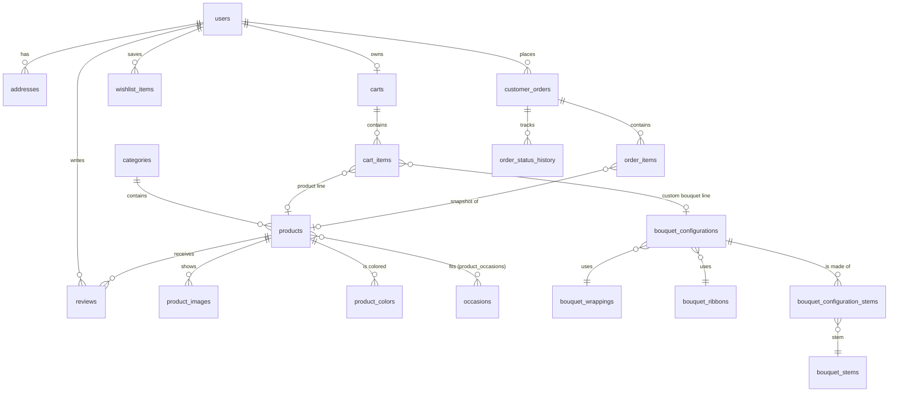

<<<<<<< HEAD
# Bloomé 🌸 — boutique de fleurs en ligne

Bloomé is a full-stack flower e-commerce application: an editorial French-language storefront
(catalogue, product pages, a "Build your bouquet" workshop, cart, cash-on-delivery checkout,
order tracking, customer account) and a protected back office (dashboard, orders, products,
inventory, categories, customers).

| Layer     | Technology |
|-----------|------------|
| Frontend  | Angular 22 (standalone components, signals, reactive forms, router guards, HTTP interceptor), TypeScript strict, SCSS, Vitest, ESLint |
| Backend   | Java 21, Spring Boot 3.5 (Web, Data JPA, Security, Validation, Actuator), springdoc-openapi, Maven |
| Database  | PostgreSQL 16, Flyway migrations |
| Tooling   | Docker Compose, Maven wrapper, Prettier, smoke-test script |

---

## Contents

1. [Quick start](#quick-start)
2. [Prerequisites](#prerequisites)
3. [Configuration (environment variables)](#configuration)
4. [Running the backend](#running-the-backend)
5. [Running the frontend](#running-the-frontend)
6. [Docker](#docker)
7. [Local development accounts](#local-development-accounts)
8. [Architecture](#architecture)
9. [Database schema](#database-schema)
10. [REST API](#rest-api)
11. [Business rules](#business-rules)
12. [Security](#security)
13. [Testing](#testing)
14. [Troubleshooting](#troubleshooting)
15. [Deployment considerations](#deployment-considerations)
16. [Known limitations and next steps](#known-limitations-and-next-steps)

---

## Quick start

```bash
cp .env.example .env                 # then edit the passwords
docker compose up -d postgres        # PostgreSQL 16 on localhost:5432 (+ bloome_test database)

cd backend && ./mvnw spring-boot:run # API on http://localhost:8080 (migrations + demo catalog load automatically)
# Windows: mvnw.cmd spring-boot:run

cd frontend && npm install && npm start   # http://localhost:4200
```

Open <http://localhost:4200>. API documentation: <http://localhost:8080/swagger-ui.html>.

## Prerequisites

| Tool | Version | Notes |
|------|---------|-------|
| JDK | 21 | `java -version` |
| Node.js | 22.22.3+ or 24.15+ | required by Angular 22 |
| npm | 10+ | |
| Docker + Docker Compose | recent | optional if you install PostgreSQL yourself |
| PostgreSQL | 16 (14+ works) | only if not using Docker |

Maven does not need to be installed: the project ships the Maven wrapper (`mvnw` / `mvnw.cmd`).

**Without Docker**, create the databases yourself:

```sql
CREATE USER bloome WITH PASSWORD 'your-password' CREATEDB;
CREATE DATABASE bloome OWNER bloome;
CREATE DATABASE bloome_test OWNER bloome;   -- used by the integration tests
```

The first migration runs `CREATE EXTENSION IF NOT EXISTS pg_trgm` (trigram indexes for search).
`pg_trgm` is a trusted extension since PostgreSQL 13, so the database owner can create it.

## Configuration

The backend reads environment variables; for local development it also reads the project's `.env`
file automatically (real environment variables take precedence). All variables are listed in
[`.env.example`](.env.example).

| Variable | Default | Purpose |
|----------|---------|---------|
| `DB_URL` | `jdbc:postgresql://localhost:5432/bloome` | JDBC URL |
| `DB_USERNAME` / `DB_PASSWORD` | `bloome` / *(empty)* | database credentials |
| `CORS_ALLOWED_ORIGINS` | `http://localhost:4200` | exact allowed origins (comma separated) |
| `SESSION_COOKIE_SECURE` | `false` | set `true` behind HTTPS |
| `SESSION_TIMEOUT` | `8h` | server session lifetime |
| `AUTH_RATE_LIMIT_PER_MINUTE` | `10` | login / register / password-change attempts per IP per minute |
| `FLYWAY_LOCATIONS` | `classpath:db/migration,classpath:db/seed` | drop `db/seed` in production |
| `BLOOME_ADMIN_EMAIL` / `BLOOME_ADMIN_PASSWORD` | *(empty)* | creates an administrator at startup if both are set (password ≥ 12 chars) |
| `BLOOME_DEMO_ACCOUNTS` | `false` | creates the documented development accounts |
| `TEST_DB_URL` / `TEST_DB_USERNAME` / `TEST_DB_PASSWORD` | `…/bloome_test`, `bloome`, `bloome_dev` | integration-test database |

Shop rules (delivery fee, free-delivery threshold, gift-wrap fee, same-day cut-off, served cities,
bouquet stem limits) live under `bloome.shop` / `bloome.bouquet` in
`backend/src/main/resources/application.yml`.

## Running the backend

```bash
cd backend
./mvnw spring-boot:run          # dev run (uses .env)
./mvnw test                     # 49 unit + integration tests against PostgreSQL (bloome_test)
./mvnw package                  # builds target/bloome-backend-1.0.0.jar (runs tests)
java -jar target/bloome-backend-1.0.0.jar
```

- **Migrations** run automatically at startup (Flyway). Schema: `src/main/resources/db/migration`.
- **Seed data** (5 categories, 6 occasions, 20 products with photos, 12 bouquet stems, wrappings and
  ribbons, prices in MAD) is the separate Flyway location `src/main/resources/db/seed`, loaded in
  development and excluded in production with `FLYWAY_LOCATIONS=classpath:db/migration`.
- Hibernate only **validates** the schema (`ddl-auto: validate`); it never modifies it.
- Health check: `GET /actuator/health`. OpenAPI: `/v3/api-docs`, Swagger UI: `/swagger-ui.html`.

## Running the frontend

```bash
cd frontend
npm install
npm start            # http://localhost:4200 — /api is proxied to http://localhost:8080 (proxy.conf.json)
npm run build        # production build (dist/frontend/browser)
npm run test:ci      # 25 unit/component tests
npm run lint
```

The dev proxy makes the browser see a single origin, which is how the app is meant to be deployed
(the API behind the same domain), so the session and CSRF cookies work without cross-site settings.

## Docker

```bash
cp .env.example .env
docker compose up -d postgres                     # database only (development)
docker compose --profile full up -d --build       # PostgreSQL + API + web (nginx) on http://localhost:8081
```

In the `full` profile nginx serves the Angular build and proxies `/api` to the backend.
Set `BLOOME_DEMO_ACCOUNTS=true` in `.env` to get the development accounts.

## Local development accounts

> ⚠️ **Development only.** These accounts are created only when `BLOOME_DEMO_ACCOUNTS=true`.
> Never enable this flag in production and never reuse these passwords anywhere else.

| Role | E-mail | Password |
|------|--------|----------|
| Administrator | `admin@bloome.local` | `BloomeAdmin2026` |
| Customer | `client@bloome.local` | `BloomeClient2026` |

Production administrators are created with `BLOOME_ADMIN_EMAIL` / `BLOOME_ADMIN_PASSWORD`
(no password is hard-coded for production).

## Architecture

```
bloome/
├── backend/                     Spring Boot API
│   └── src/main/java/ma/bloome/
│       ├── config/              security, OpenAPI, typed properties, account bootstrap
│       ├── security/            session principal, CSRF handler, rate limiter, JSON 401/403
│       ├── controller/          thin REST controllers (/api/v1)
│       ├── service/             business logic, pricing, checkout, inventory, delivery rules
│       │   ├── admin/           dashboard, product & catalog administration
│       │   └── payment/         PaymentGateway extension point + cash on delivery
│       ├── repository/          Spring Data JPA (+ atomic stock updates, specifications)
│       ├── entity/              JPA entities and enums (OrderStatus owns its transitions)
│       ├── dto/                 request/response records (entities are never exposed)
│       ├── mapper/              entity → DTO mapping
│       ├── exception/           ApiException hierarchy + global handler (uniform ApiError)
│       └── validation/          @PhoneNumber, @StrongPassword, @SafeImageUrl
├── frontend/                    Angular app
│   └── src/app/
│       ├── core/                services (auth, cart, catalog, orders, account, admin, ui), guards, interceptor
│       ├── shared/              product card, quantity selector, states, pagination, order view, pipes, validators
│       ├── layout/              header, footer, shop layout
│       ├── features/            home, catalog, product, builder, cart, checkout, auth, account, info pages
│       ├── admin/               back office (lazy loaded, admin guard)
│       └── models/              API types and French labels
├── docker/                      PostgreSQL init (test database)
├── scripts/smoke-test.sh        end-to-end HTTP checks (session + CSRF)
├── docker-compose.yml
└── .env.example
```

**Accessibility.** Semantic landmarks, a skip link, visible focus styles, labelled controls,
`aria-live` announcements for cart totals and toasts, focus moved into the mobile menu, a native
`<dialog>` for confirmations, AA colour contrast and `prefers-reduced-motion` support.

**Design system.** Palette from the brief (cream `#FFF9F3`, blush `#F6E5E5`, dusty rose `#C77983`,
burgundy `#663B45`, sage `#9AA78D`, ink `#302A29`) with darker variants for AA-contrast text.
Typography: *Fraunces* (soft, high optical size) for headings and the wordmark, *Figtree* for UI text,
both self-hosted through `@fontsource` (no third-party font requests). The signature shape is the
**arched frame** (a florist's window), reused for hero, category, product and cart imagery.
Layout uses CSS logical properties so an Arabic/RTL mode can be added (`dir="rtl"`); all UI strings
are French while code and API naming stay English.

**Product photos** are Unsplash images (Unsplash License) referenced by URL; every `` has a
botanical SVG fallback if an image cannot load.

## Database schema



Key decisions (see `V1__initial_schema.sql`):

- **Money** is `NUMERIC(10,2)` ↔ `BigDecimal`; **timestamps** are `TIMESTAMPTZ` stored in UTC
  (`Instant`); delivery dates are `DATE`. Business "today" uses the shop zone `Africa/Casablanca`.
- **CHECK constraints** on prices, stock (≥ 0), quantities, ratings and every enum column
  (roles, order/payment statuses, payment methods, slots, colours).
- **Unique**: lower-case e-mail, order reference, category/product slugs, one wishlist entry and one
  review per user/product, one cart per user, one cart line per product (partial unique index),
  one order per `(user, idempotency_key)`.
- **Order snapshots**: `order_items` store the product name, image, unit price, quantity, line
  total and, for custom bouquets, a JSONB `configuration_snapshot` (stems, prices, wrapping, ribbon,
  message). Product FKs are `ON DELETE SET NULL`; orders reference users with `ON DELETE RESTRICT`,
  so history is never cascade-deleted. Products are deactivated, not deleted.
- **Indexes**: trigram (GIN) on product name/description for search, category, price, creation
  date, order `(user_id, created_at)`, `(status, created_at)`, foreign keys used in joins.
- `products.version` supports optimistic locking for admin edits.

## REST API

All endpoints are under `/api/v1`, return JSON, and use the error shape
`{ timestamp, status, code, message, path, fieldErrors? }` (messages in French, no stack traces).
Paginated responses: `{ content, page, size, totalElements, totalPages, first, last }`.
Interactive documentation: **`/swagger-ui.html`**.

| Method & path | Access | Description |
|---------------|--------|-------------|
| `POST /auth/register` | public | create a customer (role is always CUSTOMER) and sign in |
| `POST /auth/login` · `POST /auth/logout` | public | open / close the session |
| `GET /auth/me` | public (401 if anonymous) | current user |
| `GET /auth/csrf` | public | issues the `XSRF-TOKEN` cookie |
| `GET /products` | public | `q, category*, occasion*, color*, minPrice, maxPrice, inStock, sort (POPULARITY, NEWEST, PRICE_ASC, PRICE_DESC, NAME_ASC, NAME_DESC), page, size` |
| `GET /products/{idOrSlug}` · `/related` | public | details (with delivery estimate) and related products |
| `GET /products/featured` · `/bestsellers` | public | home-page selections |
| `GET /categories` · `/occasions` · `/catalog/facets` | public | reference data and filter facets |
| `GET /bouquet/options` · `/delivery/options` | public | builder options; cities, slots, dates and fees |
| `POST /cart/quote` | public | prices an anonymous (browser) cart, nothing stored |
| `GET /cart` · `POST /cart/items` · `PATCH/DELETE /cart/items/{id}` · `DELETE /cart` | customer | server cart (product or custom bouquet lines) |
| `POST /cart/merge` | customer | merges the browser cart after login |
| `GET /wishlist` · `POST/DELETE /wishlist/items/{productId}` | customer | favourites |
| `POST /orders` | customer | cash-on-delivery checkout (idempotent per `idempotencyKey`) |
| `GET /orders/my` · `GET /orders/{id}` · `POST /orders/{id}/cancel` | customer (own orders only) | history, tracking, cancellation |
| `GET/POST /products/{idOrSlug}/reviews` | read public / write verified buyer | reviews |
| `PUT /account/profile` · `PUT /account/password` · `GET/POST/PUT/DELETE /account/addresses[/{id}]` | customer | account |
| `POST /newsletter` | public | idempotent subscription |
| `GET /admin/dashboard` | admin | live metrics |
| `GET/POST /admin/products` · `GET/PUT/DELETE /admin/products/{id}` · `PATCH /admin/products/{id}/stock` | admin | products (DELETE = deactivate), atomic stock delta |
| `POST/PUT/DELETE /admin/categories[/{id}]` | admin | categories (non-empty ones cannot be deleted) |
| `GET /admin/inventory` · `PATCH /admin/stems/{id}/stock` | admin | stock of products and bouquet stems |
| `GET /admin/orders` · `GET /admin/orders/{id}` · `PATCH /admin/orders/{id}/status` | admin | search (`status, q, from, to`), details, status transitions |
| `GET /admin/customers` · `GET /admin/customers/{id}` | admin | customers with order counts and spend |

## Business rules

- **Prices** are always computed by the backend (`CartPricingService`) for the cart, the anonymous
  quote and checkout. Client-sent prices are ignored. Checkout may send `expectedTotal`; if the
  server total differs the order is refused with `PRICE_CHANGED` so the customer reviews it.
- **Delivery**: 35 MAD, free from 500 MAD; gift wrapping 25 MAD. Same-day delivery for orders
  before 14:00 (Casablanca time) on slots starting at least 2 h later; bookable up to 30 days
  ahead; served cities: Rabat, Salé, Témara, Kénitra, Casablanca, Mohammédia.
- **Custom bouquets**: 5–40 stems, per-stem limits, active wrapping/ribbon; price = wrapping +
  ribbon + Σ stems; up to 5 identical bouquets per line.
- **Checkout** runs in one transaction: lock the cart row → re-price → validate delivery →
  reserve stock with conditional atomic updates (`UPDATE … SET stock = stock - q WHERE stock >= q`,
  rows in ascending id order) → persist order + snapshots + history → empty cart. Any failure rolls
  everything back; the cart is preserved. The same idempotency key returns the original order.
- **Order lifecycle** (`OrderStatus`):
  `PENDING → CONFIRMED → PREPARING → OUT_FOR_DELIVERY → DELIVERED`, with `CANCELLED` reachable from
  PENDING, CONFIRMED (customer or admin) and PREPARING (admin only). Cancelling restores stock.
  DELIVERED marks cash-on-delivery orders as PAID.
- **Revenue** on the dashboard = sum of totals (delivery included) of all non-cancelled orders;
  "encaissé" = delivered orders.
- **Reviews**: one per customer and product, only after a delivered order containing it.
- **Payments**: `PaymentGateway` is the extension point (e.g. Stripe: create a payment intent in
  `initiate`, confirm via webhook). Orders are never marked paid without a confirmed payment.

## Security

- **Authentication**: server-side session; the browser holds only the `BLOOME_SESSION` cookie
  (HttpOnly, SameSite=Lax, `Secure` in production). Session id is rotated at login; logout
  invalidates the session. No token is stored in `localStorage`.
- **CSRF**: double-submit cookie. The API sets a readable `XSRF-TOKEN` cookie; Angular sends it back
  in `X-XSRF-TOKEN` on every mutating request. Login and registration are protected too.
- **Passwords**: Spring Security's delegating encoder (BCrypt), min. 8 characters with a letter and
  a digit; hashes are never serialised.
- **Authorisation** is enforced on the server: URL rules (`/api/v1/admin/**` → ADMIN) plus
  `@PreAuthorize` on the admin controller. Ownership is part of every customer query (cart items,
  orders, addresses), so another customer's order returns 404 (no IDOR).
- **Validation** on every DTO (Bean Validation) and again in services (stock, delivery, bouquet
  rules). JPA criteria / parameterised queries only; `LIKE` wildcards are escaped.
- **Errors** never expose stack traces or exception messages; unexpected errors are logged.
- **CORS** limited to configured origins; **rate limiting** on login/register/password change, per client IP.
  Behind nginx the client IP is read from `X-Forwarded-For` only when the request comes from a
  private-network proxy (`server.forward-headers-strategy: native`), so it cannot be spoofed by clients.
- The **CSRF token is rotated** at login and logout.
- **Images** are URLs validated as `https://…` or `/assets/…` (no file upload surface).
- Secrets only via environment variables; `.env` is git-ignored.

**Remaining for production**: HTTPS termination and `SESSION_COOKIE_SECURE=true`; distributed
rate limiting at the gateway (the built-in limiter is per instance); Spring Session (Redis/JDBC)
if running several API instances; e-mail verification and a password-reset flow (requires an
e-mail provider); a Content-Security-Policy on the web server; legal review of the CGV and
privacy pages; monitoring/alerting.

## Testing

| Suite | Command | Result (last run) |
|-------|---------|-------------------|
| Backend unit + integration (real PostgreSQL, MockMvc, full security chain) | `cd backend && ./mvnw test` | **49 passed** |
| Frontend unit/component (Vitest + jsdom) | `cd frontend && npm run test:ci` | **25 passed** |
| Frontend lint | `npm run lint` | clean |
| Production builds | `./mvnw package` · `npm run build` | succeed |
| HTTP smoke test (session + CSRF) | `scripts/smoke-test.sh [http://localhost:4200]` | **21 passed** |
| Accessibility (axe-core, WCAG 2 A/AA + best practices) | 26 pages + 10 interactive states (menus, dialog, form errors) | **0 violations** |

Backend tests cover catalogue filtering/sorting/search escaping, registration and login, CSRF,
role-based access, cart operations and ownership, server-side pricing, anonymous quote and cart
merge, bouquet validation, checkout validation, successful orders with snapshots, stock decrement,
rollback on insufficient stock, **6 concurrent customers racing for the last unit (exactly one
succeeds, stock never negative)**, idempotent re-submission, order ownership, cancellation rules,
status transitions, review eligibility, product validation, optimistic locking, atomic stock
adjustment and dashboard revenue. The test database (`bloome_test`) is cleaned and re-migrated on
every run.

Frontend tests cover price formatting, validators, safe return URLs, the quantity selector,
product card rendering, empty/error states, the visitor cart (no prices stored locally), route
guards, catalogue URL ↔ filter mapping, catalogue rendering/empty/error states and checkout
validation and submission.

## Troubleshooting

| Symptom | Fix |
|---------|-----|
| `password authentication failed` at startup | `DB_PASSWORD` in `.env` must match `POSTGRES_PASSWORD` (the Docker volume keeps the first password: `docker compose down -v` to reset) |
| `permission denied to create extension "pg_trgm"` | use PostgreSQL ≥ 13 and make `bloome` the database owner, or create the extension as a superuser once |
| Tests fail with `database "bloome_test" does not exist` | create it (see Prerequisites); the Docker init script creates it on first start |
| Every POST returns 403 `CSRF_INVALID` | call the API through the Angular dev server (`npm start`) or the nginx container, not from another origin; when using curl, send the `XSRF-TOKEN` cookie value in `X-XSRF-TOKEN` |
| Login works but you are immediately logged out | in production behind HTTP (not HTTPS) keep `SESSION_COOKIE_SECURE=false` |
| Images show a pink flower illustration | the Unsplash CDN is unreachable from your network; the fallback is intentional |
| `ng serve` fails on Node version | Angular 22 needs Node 22.22.3+ or 24.15+ |
| Port 5432 already used | set `POSTGRES_PORT=5433` in `.env` and update `DB_URL` |

## Deployment considerations

- Build images with `docker compose --profile full build` or the two Dockerfiles; serve the web
  app and API **on the same domain** (nginx config provided) behind HTTPS.
- Production variables: `FLYWAY_LOCATIONS=classpath:db/migration`, `SESSION_COOKIE_SECURE=true`,
  `BLOOME_DEMO_ACCOUNTS=false`, `BLOOME_ADMIN_EMAIL/PASSWORD` for the first administrator (then
  remove the password variable), exact `CORS_ALLOWED_ORIGINS`.
- New schema changes: add `V4__…sql` and above in `db/migration` (V2 is the demo seed, V3 adds search and foreign-key indexes).
- Consider disabling Swagger UI in production (`springdoc.swagger-ui.enabled=false`).
- Back up PostgreSQL; the order tables are append-mostly and keep full price snapshots.

## Known limitations and next steps

- Payment: cash on delivery only (card payment designed as a `PaymentGateway` implementation).
- No promo-code engine yet (the `discount` column and UI line are ready).
- No password-reset by e-mail (needs an e-mail provider); password change is available in the account.
- Product images are managed as URLs, not uploads.
- The interface is French-only; the layout is RTL-ready for a future Arabic translation.
=======
# Bloom-
>>>>>>> ea0bfde4112660be19d104097f8a97890ac1d8c2
